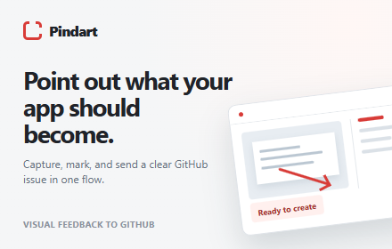
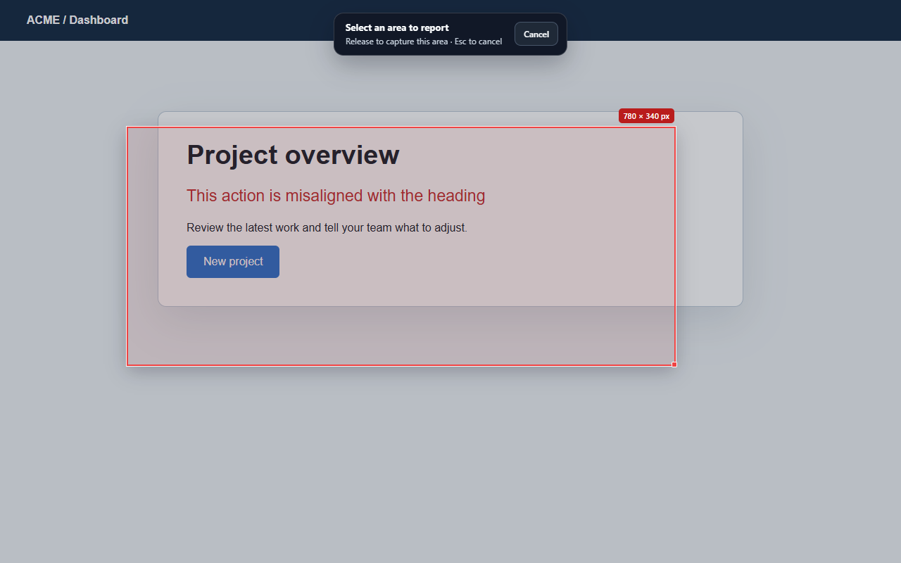
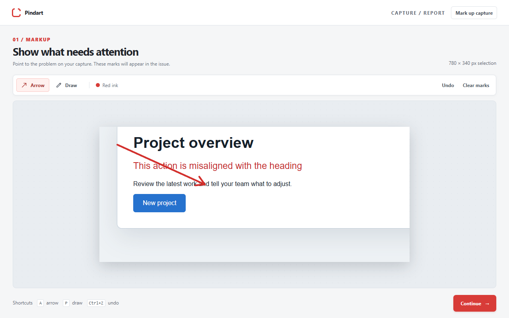
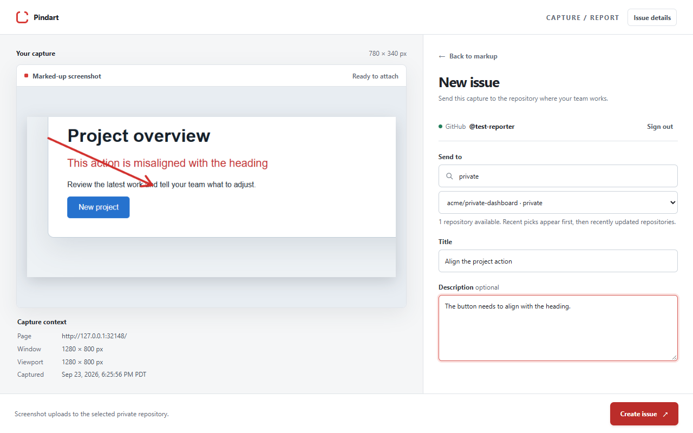
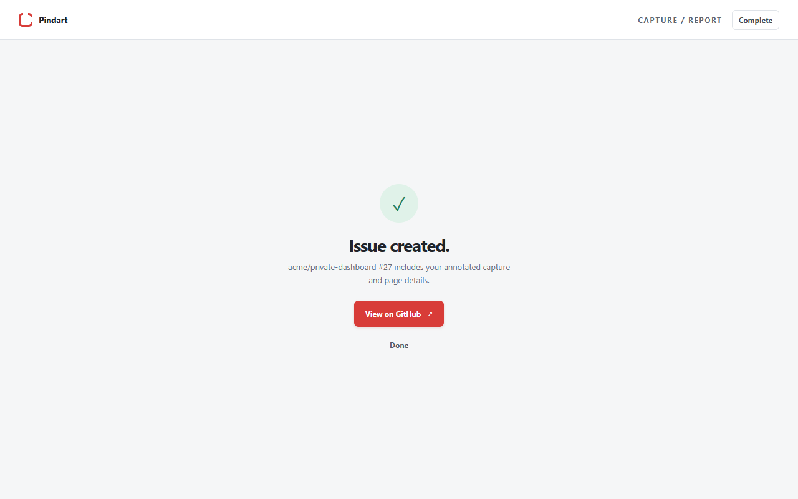

<p align="center">
  
</p>

<h1 align="center">Pindart</h1>

<p align="center">
  <strong>Point at what's wrong on a web page. Get a clear GitHub issue.</strong><br>
  A Chrome extension that turns a marked-up screenshot into a GitHub issue in one flow.
</p>

<p align="center">
  <a href="https://github.com/NathanPannell/Pindart/actions/workflows/ci.yml"></a>
  <a href="LICENSE"></a>
  
  
</p>

---

## What is Pindart?

Writing a good bug report for something visual is tedious. You take a screenshot, crop it, draw on it in another app, save it, open GitHub, pick the repo, drag the image in, then type out which page you were on and how big your window was.

Pindart does all of that in about ten seconds:

1. **Select.** Press <kbd>Ctrl</kbd>+<kbd>Shift</kbd>+<kbd>Y</kbd> (or click the toolbar icon) and drag over the part of the page that needs attention.
2. **Mark it up.** Draw red arrows and freehand circles to point at the exact problem.
3. **Send it.** Pick a repository, add a title, and click **Create issue**.

The issue lands in GitHub with your annotated screenshot and the details a developer needs to reproduce it: the page URL, browser window size, viewport size, and capture time.

| 1. Select a region | 2. Mark it up |
| --- | --- |
|  |  |
| **3. Create the issue** | **4. Done** |
|  |  |

## What the issue looks like

Every issue Pindart creates follows the same simple format:

```markdown
The button needs to align with the heading.

### Capture context
- Page: https://example.com/dashboard
- Browser window: 1280 × 800 px
- Page viewport: 1280 × 800 px
- Captured: Sep 23, 2026, 6:25:56 PM PDT


[Open full-size screenshot](https://github.com/user-attachments/assets/…)
```

## Features

- **Capture only what matters.** Drag-select any visible part of the page. Browser controls and other windows are never included.
- **Sharp on any screen.** Captures account for browser zoom and high-DPI displays.
- **Simple markup.** Arrows, freehand drawing, undo, and clear, with keyboard shortcuts (<kbd>A</kbd> arrow, <kbd>P</kbd> draw, <kbd>Ctrl</kbd>+<kbd>Z</kbd> undo).
- **Works with private repos.** Lists every repository you can push to, with recently used ones first and search for the rest.
- **Never lose a draft.** Your capture, markup, title, and description are saved as you type. If something fails, nothing is lost. Just retry.
- **Lightweight.** Plain JavaScript with no frameworks, no build step, and no runtime dependencies.

## Install

> [!IMPORTANT]
> **Pindart is self-hosted only.** It is not on the Chrome Web Store, and there is no public sign-in service you can use. To use it, you run your own copy of the small sign-in service in [`backend/`](backend) and connect it to your own GitHub OAuth App. There are no plans to offer a hosted version.

Setup usually takes under an hour, and free tiers of common hosts are enough. You'll need:

- **Google Chrome** to load the extension.
- **A GitHub account** to create an OAuth App for sign-in.
- **A host for a small Python web service** with HTTPS, such as [Railway](https://railway.com) or [Render](https://render.com).
- **A PostgreSQL database**, such as [Neon](https://neon.tech).

The [setup instructions](#setup-instructions-for-agents) at the bottom of this page walk through every step. They're written so an AI coding agent can do the setup for you: point your agent at this README and ask it to set up Pindart.

In short, you'll:

1. Download or clone this repository.
2. Load it in Chrome from `chrome://extensions` with **Developer mode** on and **Load unpacked**.
3. Deploy the sign-in service, create a GitHub OAuth App, and connect the two.
4. Point the extension at your service in `config.js` and `manifest.json`, then reload it.

Until step 4 is done, the extension can capture and mark up screenshots, but it can't sign in to GitHub or create issues.

## Privacy and permissions

Pindart only does something when you ask it to. It doesn't read pages in the background, track you, or send data anywhere except GitHub and the sign-in service you run yourself.

| Permission | Why Pindart needs it |
| --- | --- |
| `activeTab`, `scripting` | Show the selection overlay and take a screenshot of the tab you're on, only after you click the icon or press the shortcut. |
| `storage`, `unlimitedStorage` | Keep your current capture and draft on your computer so nothing is lost. |
| `identity` | Open the GitHub sign-in window. |
| GitHub API access | List your repositories, upload the screenshot, and create the issue. |

**About GitHub access:** Pindart asks GitHub for the `repo` scope. GitHub doesn't offer an "issues only" permission for this kind of app, so `repo` is the narrowest option that works with private repositories. Pindart only uses it to list repositories, upload screenshots, and create issues. Your sign-in is stored locally in Chrome. **Sign out** clears it, and you can revoke access anytime from [GitHub's authorized applications page](https://github.com/settings/applications).

**About screenshots:** Images are uploaded to GitHub as issue attachments. In private repositories, GitHub normally requires repository access to view them, so review sensitive content before you submit.

Because you host the sign-in service yourself, no one else handles your sign-in. Read the [security policy](SECURITY.md) for how tokens are protected.

## Good to know

- The screenshot upload uses the same GitHub endpoint as the official [GitHub CLI](https://github.com/cli/cli). GitHub doesn't document it as a public API, so it could change.
- GitHub limits images to 10 MB. If a capture is too large, select a smaller region.
- The editor window stays open after an issue is created so you can view it or start another capture.

## How it's built

| Part | Location | What it does |
| --- | --- | --- |
| Chrome extension | repository root | Region selection (`select.js`), markup and issue form (`editor.*`), GitHub calls in the background worker (`background.js`, `github.js`) |
| Sign-in service | [`backend/`](backend) | Small FastAPI app that keeps the GitHub OAuth secret off users' machines and hands the extension its tokens safely |
| Docs | [`docs/`](docs) | [Architecture notes](docs/ARCHITECTURE.md), [design system](docs/DESIGN.md), and [archived Chrome Web Store materials](docs/chrome-web-store) |

## Contributing

Issues and pull requests are welcome. See [CONTRIBUTING.md](CONTRIBUTING.md) for how to run the tests and try changes locally. The best way to report a visual bug in Pindart is with Pindart.

## License

[MIT](LICENSE) © 2026 Nathan Pannell

---

## Setup instructions for agents

These steps are written for an AI coding agent (or a developer) setting up a fully working Pindart from source. There is no hosted sign-in service, so every installation needs its own, and these steps include deploying it. Follow them in order. Every value marked `<like-this>` must be replaced.

### What you need from the human

Ask for these up front, before you start. Everything else can be done without them.

1. Access to a **GitHub account** that can create an OAuth App (Settings → Developer settings → OAuth Apps).
2. A place to **host a small Python web service over HTTPS**. This repo includes config for [Railway](https://railway.com) (`backend/railway.json`), but any host that runs `uvicorn` works.
3. A **PostgreSQL database**. [Neon](https://neon.tech) works well. Any Postgres 14+ is fine.
4. **Google Chrome** on the machine where the extension will be loaded.

Never commit the OAuth client secret, database URLs, or the encryption key. Store them only in the host's secret settings.

### 1. Verify the code

```bash
git clone https://github.com/NathanPannell/Pindart.git
cd Pindart
npm run check
npm test
cd backend
python -m pip install -r requirements-dev.txt
python -m pytest -q
cd ..
```

Requires Node 20+ and Python 3.11+. All tests should pass before you continue.

### 2. Load the extension and get its redirect URL

1. Open `chrome://extensions`, enable **Developer mode**, click **Load unpacked**, and select the repository root.
2. Copy the 32-letter **extension ID** shown on the Pindart card.
3. The extension's sign-in redirect URL is `https://<extension-id>.chromiumapp.org/github`. Save it for step 5.

The ID of an unpacked extension depends on its folder path. If you move the folder, the ID changes and step 5 must be updated. To pin the ID, add a `"key"` to `manifest.json` ([Chrome docs](https://developer.chrome.com/docs/extensions/reference/manifest/key)).

### 3. Create the database

Create a Postgres database and note two connection strings:

- `DATABASE_URL`: the pooled connection string used by the running service.
- `DATABASE_URL_UNPOOLED`: a direct connection string used only for migrations. On non-Neon hosts this can be the same value.

### 4. Deploy the sign-in service (first pass)

Deploy the `backend/` folder as a web service. On Railway, set the service's root directory to `backend`. The start command is already defined:

```bash
uvicorn app.main:app --host 0.0.0.0 --port $PORT
```

Note the service's public HTTPS origin, for example `https://pindart-auth.example.com`. This is `<service-url>`. The service won't start until step 5 is complete, which is expected.

### 5. Create the GitHub OAuth App and configure the service

1. Create a GitHub OAuth App at <https://github.com/settings/applications/new>:
   - **Application name:** `Pindart` (or your own name)
   - **Homepage URL:** this repository's URL
   - **Authorization callback URL:** `<service-url>/auth/github/callback`
   - Leave **Enable Device Flow** off.
2. Copy the **Client ID** and generate a **Client secret**.
3. Generate an encryption key:

   ```bash
   python -c "import base64,secrets; print(base64.urlsafe_b64encode(secrets.token_bytes(32)).decode().rstrip('='))"
   ```

4. Set these environment variables on the service:

   | Variable | Value |
   | --- | --- |
   | `GITHUB_CLIENT_ID` | OAuth App client ID |
   | `GITHUB_CLIENT_SECRET` | OAuth App client secret |
   | `PUBLIC_BASE_URL` | `<service-url>` with no trailing slash |
   | `EXTENSION_REDIRECT_URI` | `https://<extension-id>.chromiumapp.org/github` from step 2 |
   | `DATABASE_URL` | Pooled Postgres connection string |
   | `DATABASE_URL_UNPOOLED` | Direct Postgres connection string |
   | `TOKEN_ENCRYPTION_KEY` | The key generated above |

5. Run the database migration once. It's safe to repeat. From `backend/`, with `DATABASE_URL_UNPOOLED` set:

   ```bash
   python -m app.migrate
   ```

6. Redeploy, then confirm the service is ready. It should return HTTP 200:

   ```bash
   curl -i <service-url>/ready
   ```

### 6. Point the extension at your service

Edit two files in the repository root. They ship with placeholder values that must be replaced:

- `config.js`: set `GITHUB_CLIENT_ID` to your client ID and `AUTH_API_BASE_URL` to `<service-url>/`. The trailing slash is required.
- `manifest.json`: in `host_permissions`, replace `https://your-sign-in-service.example.com/*` with `<service-url>/*`.

Then click the reload icon on the Pindart card in `chrome://extensions`.

### 7. Test end to end

1. Open any web page, press <kbd>Ctrl</kbd>+<kbd>Shift</kbd>+<kbd>Y</kbd>, and drag to select a region.
2. Draw an arrow, click **Continue**, then **Sign in with GitHub** and approve.
3. Pick a repository you can push to, enter a title, and click **Create issue**.
4. Open the created issue and confirm that the screenshot and capture context appear.

If sign-in fails with "returned to an unexpected address" or the service rejects the redirect, the extension ID no longer matches `EXTENSION_REDIRECT_URI`. Repeat step 2 and update the variable.

### 8. Optional: package as a ZIP

```powershell
powershell -ExecutionPolicy Bypass -File .\scripts\package-extension.ps1
```

This runs the checks and tests, then writes `dist/pindart-v<version>.zip` and a SHA-256 checksum, which is useful for sharing a configured build with a team. Pindart itself is not published to the Chrome Web Store. If you publish your own copy, it gets a new permanent extension ID, so update `EXTENSION_REDIRECT_URI` to match it. The [archived store materials](docs/chrome-web-store) may help. See [`backend/README.md`](backend/README.md) for the sign-in protocol.
